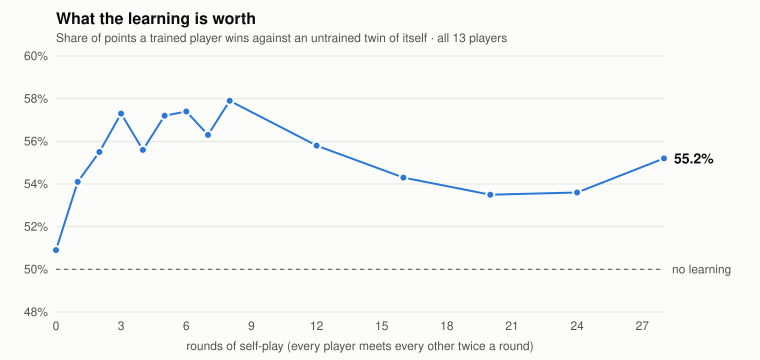

# Pixel Tennis Open

**[▶ Play in your browser](https://shawn01ee.github.io/pixel-tennis-open/)**

A pixel-art tennis match in a 45° isometric stadium, running in the browser. You don't steer the player: you choose
the shot and where it goes, and the player moves, times the swing and recovers on their own. An Auto mode plays the
whole match for you.

It is a career game: your own player on the real ranking, through a whole year on hard courts, clay and grass, with
four majors of the game's own.

## Play

**Career**: make your own player (name, country, hand, backhand, looks) and model his game on one of the thirteen.
He starts ranked 349 and climbs through Challengers, ATP 250s and 500s and the Masters 1000s to the four majors.
The ranking points are the ATP's, the rest of the ranking is the real one of 16 November 2026, and how strong every
player is comes from real Elo ratings; your level rises with every match. Play each match on court, or simulate it by
the Elo odds. Experience earns training points to put into the bars on his card; the PLAYER tab shows his card, his
own match statistics, and what a point in each bar is measured to be worth. How it all works, and what is real and
what is design, is in **[docs/career](docs/career/README.md)**.

**The four majors** are the game's own, in the spirit of the real four: the **Pixel Tennis Open** (January, a summer
hard court), the **Terre Battue Open** (late May, red clay), the **Old Lawn Championships** (late June, grass, players
in white) and the **Big City Open** (late August, a hard court under the lights). Each court is set from measurements
of real courts (how much it slows the ball, how high it bounces), and the game is checked against the real tour on
each surface, mismatches included: **[docs/surfaces](docs/surfaces/README.md)**.

Two more modes: a **Tournament** (eight players, quarter-final to final, with an on-court interview after each of your
matches) or a single **Exhibition match** against the opponent of your choice. The opponent level decides how much
of what the computer players have learned is used against you.

Matches are played to the Grand Slam rules, as at the Australian Open: sets of six games won by two, a 7-point
tiebreak at 6–6, and a 10-point tiebreak at 6–6 in the deciding set. Choose **1 set**, **best of 3 sets**, **best of
5 sets** (three sets to win, as in Grand Slam men's singles), or a single **10-point match tiebreak**. In a tournament the other matches are played out in full, in the same format, while you
play yours; the draw shows them live.

The players' numbers are fitted to their real statistics. Aces, double faults, first serves in, return points won,
how often each serve-volleys, comes in, drops, slices and lobs, and his winners and errors against the tour come
from the Tennis Abstract Match Charting Project, a shot-by-shot record of real matches. Each player is fitted until
the game reproduces them. What is real, what is fitted and what is set by hand, with the game next to the real
figures, is in **[docs/players](docs/players/README.md)**.

Players tire, by the measurements of real ones. Running wears the legs (top speed and first step), strokes wear
the arm (serve and groundstroke speed), and a long rally leaves a player short of breath, with looser shots, for the
next point or two. A perfectly timed shot is struck clean: tiredness does not show in it. A thin gauge under each
name on the scoreboard shows what is left. Where each number comes from, and what the game then does set by set
next to real Grand Slam five-setters, is in **[docs/stamina](docs/stamina/README.md)**.

The ☰ Menu (or Esc) pauses a match: step out of a career match and come back to it later, retire, or leave.

The racket hit and the bounce are real recordings (Pixabay, chosen by ear), the hit's level by the shot's pace and the
bounce by how hard the ball lands; so are the players' feet — their running steps, and a squeak on a hard court, a
slide on clay and a scuff of grass when they stop hard: **[docs/sound](docs/sound/README.md)**.

Play at <https://shawn01ee.github.io/pixel-tennis-open/>, or open `dist/pixel-tennis-open.html` in a desktop browser. It is a single file; it loads three.js from a CDN, so it
needs a network connection. Pick your player and opponent, then press **Walk out**.

| Key | Action |
|---|---|
| A / S / D / F / G | Drive (topspin) / Flat / Slice / Lob / Drop shot |
| Click on the court | Where the shot goes |
| Timing | Press the shot key as the ball arrives: *Perfect* and *Good* timing are more accurate and a little faster; too late is a mishit |
| Space | Auto on or off |
| C | Challenge a close line call (3 wrong challenges per set) |
| X | Game speed |
| V | Next camera view (Follow, Court, Behind, Stadium) |

On a phone or tablet the same choices are buttons under the thumbs. **Hold** Drive, Flat, Slice, Lob or Drop,
**slide** to aim (the target moves across the far court further than the thumb does), and **let go** to hit: the
moment you let go is the shot's timing. A tap plays the shot to where your player was going anyway, and tapping the
court also aims. To serve, tap Wide, Body or T, or hold Flat, Slice or Kick and slide into the box. Held sideways,
Auto and speed sit under the left thumb and the shots under the right. **Quick between points** (in View, on by
default on touch screens) plays the walks and ball kids between points at double speed.

## Build and test

```sh
python3 build.py                      # src/ + template.html -> dist/pixel-tennis-open.html
node tests/locomotion.test.js         # movement and footwork
node tests/match-simulation.test.js   # whole matches, computer and scripted human
node tests/crowd.test.js              # crowd reactions (statistical; can fail on an unlucky seed)
node tests/physics-realism.test.js    # ball flight and bounce against real-world figures
node tests/stamina.test.js            # the fatigue model against the declines measured in long matches
node tests/score.test.js              # Grand Slam scoring: tiebreaks, best of 3 and 5, the match tiebreak
node tests/career.test.js             # the career: Elo odds, the ranking, the points table, draws, 52 weeks, saving

node tools/train.js 6                 # self-play: the computer players learn which tactics win, saved to src/players/learned.js
node tools/train.js eval              # each trained player against an untrained twin
node tools/accuracy.js                # where each player's aimed shots land
node tools/balance.js                 # aces, double faults, serve percentages and rally length over many sets
node tools/stamina.js 100             # best-of-five matches headless: calibrates fatigue, checks it set by set, redraws docs/stamina
node tools/fit-players.js             # fits every player's numbers to his real statistics (data/mcp-players.json)
node tools/rally-check.js 24 data/rally-check.json  # how points are played (directions, net play, running) against real figures
node tools/fit-directions.js          # fits how often rally balls go down the middle and down the line
node tools/players-doc.js             # rewrites docs/players from the fit and the rally check
node tools/fit-levels.js              # fits how a player's Elo reaches the court, against Elo's odds
node tools/fit-attributes.js          # what a trained point in each bar is worth in Elo (LEVEL_FIT.attr)
node tools/career-doc.js              # rewrites docs/career from the career's data, the level fit and the training fit
node tools/surface-check.js           # how the game plays on hard, clay and grass against the real tour on each
node tools/surfaces-doc.js            # rewrites docs/surfaces from the courts' sources and the surface check
node tools/sound-check.js             # renders the ball's sounds and measures them against their sources
node tools/sound-doc.js               # rewrites docs/sound from the sounds' sources and the sound check
```

Python 3 and Node are the only requirements; there are no packages to install.

## Computer players learn

Every computer player keeps a table of what has worked for it — which serve to which corner, cross-court or down the
line, when to come in, how to pass a player at the net — and fills it in by playing. Each choice is credited when
the point is won and blamed when it is lost. The game ships with what the players learned in self-play and keeps
learning in your browser as you play; the values are stored in `localStorage`.

<picture><source media="(prefers-color-scheme: dark)" srcset="training/learning-dark.svg"></picture>

A trained player currently wins about **57.9% of points** against an untrained copy of itself — same strokes,
only the decisions differ. The model, the measurements, a player-by-player chart and each player's learned playbook
are in **[training/](training/README.md)**, redrawn every day when the players train.

The shots they play while training are analysed — correlation, mutual information, PCA and K-means of the playing
styles, decision trees and KNN, cross-validation of the learning itself — in **[training/analysis](training/analysis/README.md)**.

What the players learn from *your* matches stays in your browser. To share it, open **View → Learning → Export** in
the game: it saves `pixel-tennis-open-learning.json`, the difference between what the players know after your matches
and what they shipped with. `node tools/merge.js that-file.json` folds it into the shipped values (at half weight by
default), after which `python3 build.py` and a commit publish it to everyone.

Each player also has one signature trait on top of the ratings (`src/players/Traits.js`); `node tools/traits.js`
measures what each is worth.

How the strokes are built, each player's form and before/after pose sheets: **[docs/motion](docs/motion/README.md)**.

## Data and licence

The game's code is the project's own. The fitted player numbers (`src/players/fitted.js`) and the files in `data/`
are derived from the [Tennis Abstract Match Charting Project](https://github.com/JeffSackmann/tennis_MatchChartingProject)
and carry its licence, [CC BY-NC-SA 4.0](https://creativecommons.org/licenses/by-nc-sa/4.0/): attribution,
non-commercial use only, share alike. See [data/README.md](data/README.md).

## Layout

One class per file, grouped by what it is about. `src/manifest.json` sets the build order.

| Folder | Contents |
|---|---|
| `src/core` | constants, maths, random numbers, court dimensions |
| `src/physics` | ball flight (drag, Magnus), bounce, net, shot solver |
| `src/rules` | match formats and scoring |
| `src/players` | profiles and roster, movement, stamina, shot planning, learned tactics, the person's controls |
| `src/career` | the tournament draw and the post-match interview |
| `src/match` | the match itself, umpire, ball kids, crowd mood, commentary |
| `src/render` | renderer, camera, figures (skeleton, body mesh, footwork), ball, effects |
| `src/stadium` | court surface, stands, crowd, LED boards, big screen |
| `src/audio` | synthesised hits, crowd and umpire voice |
| `src/ui` | scoreboard, controls, menus, setup and result screens |
| `src/app` | input, game loop, entry point |
