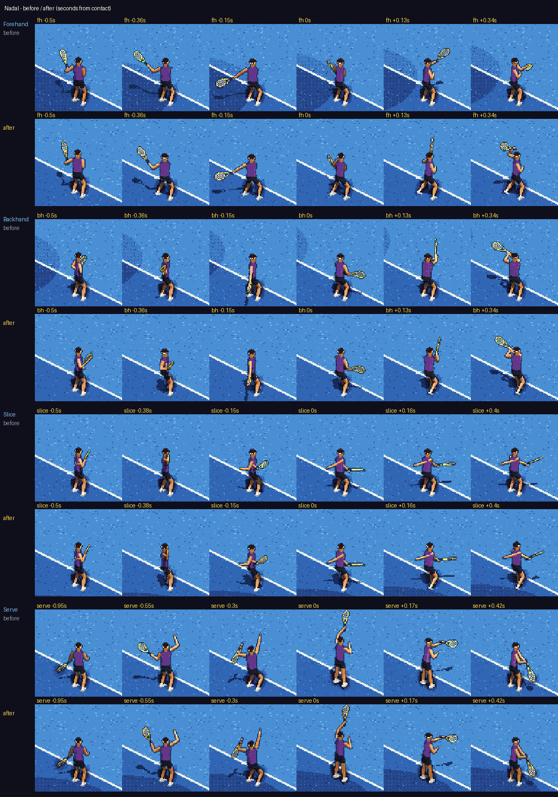
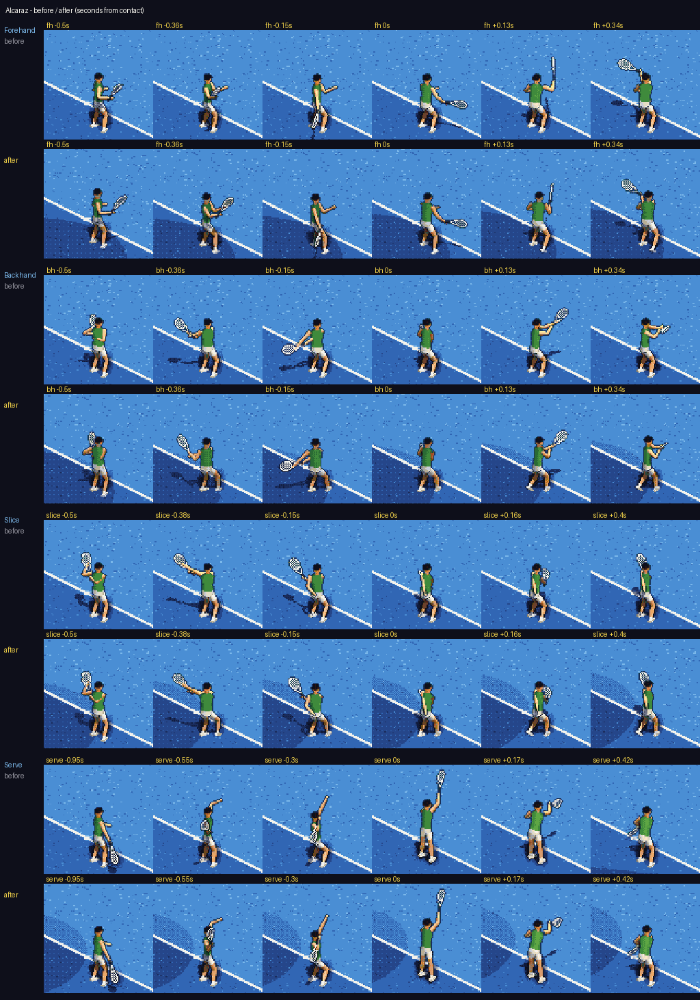
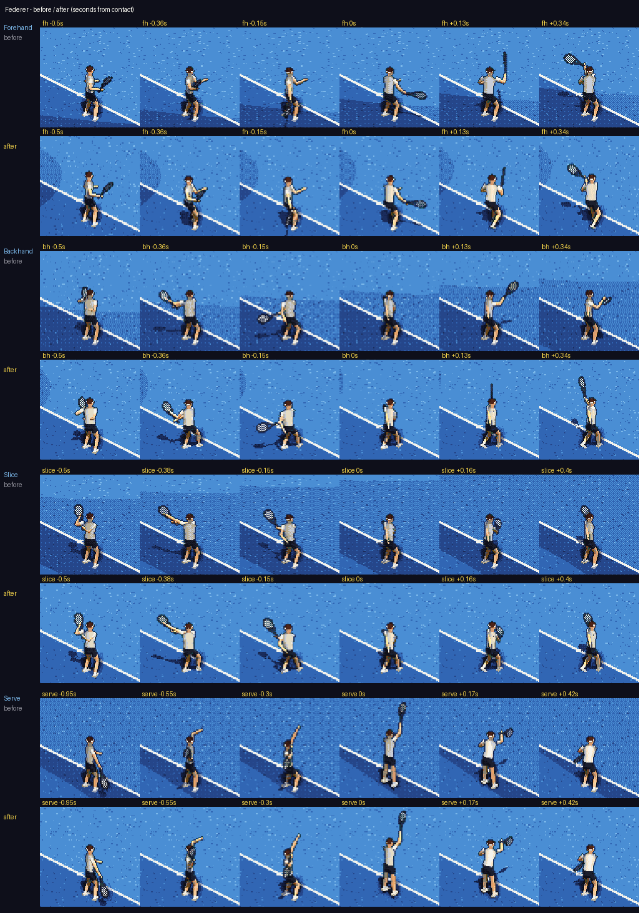
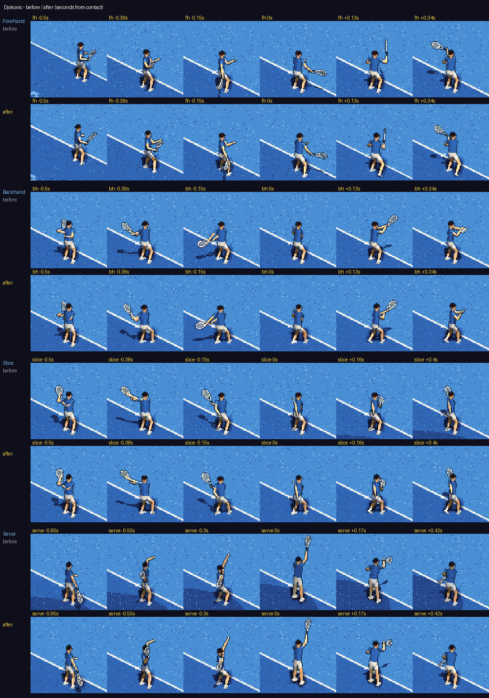
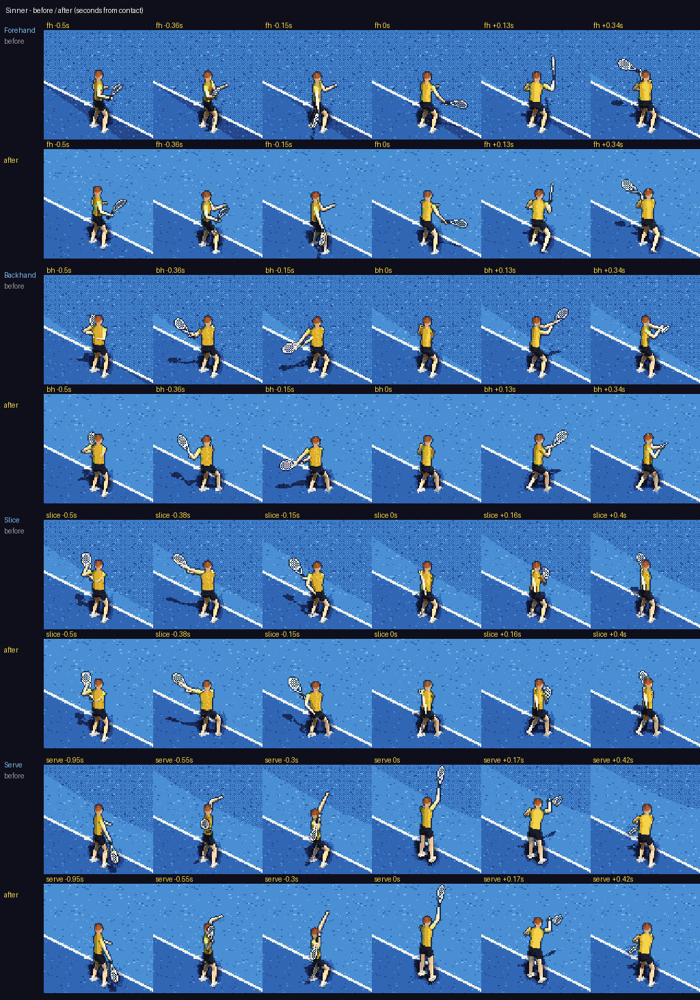
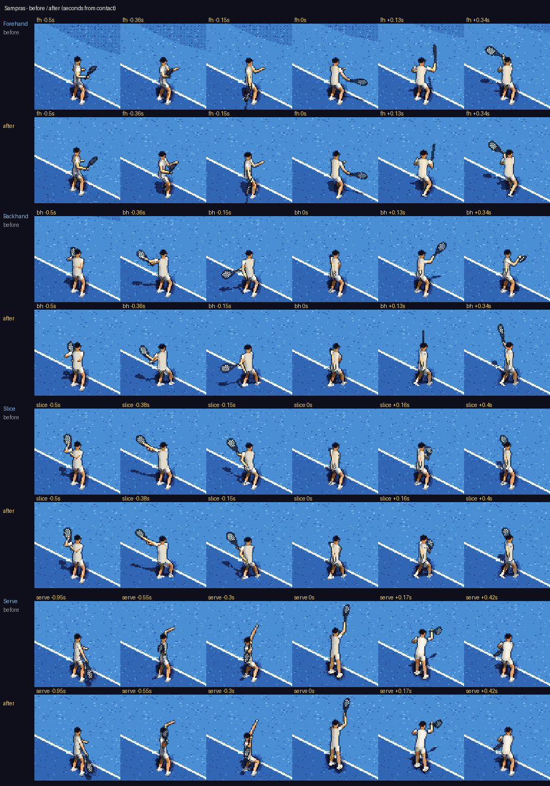
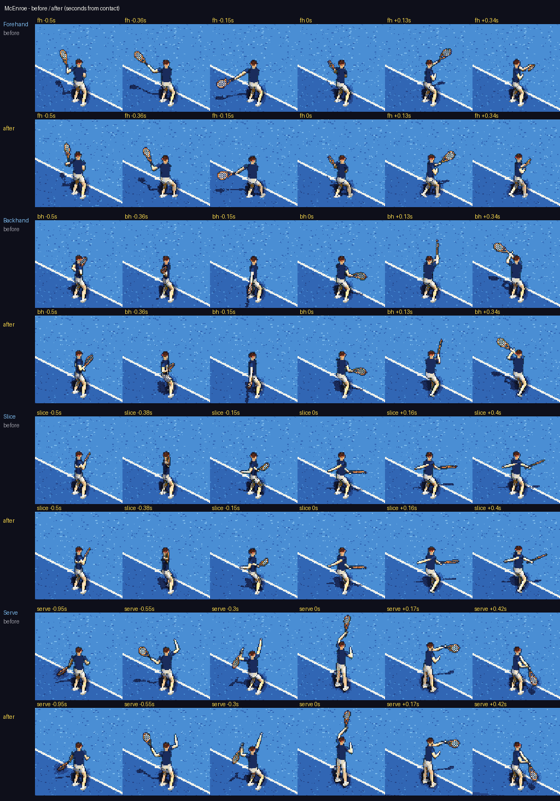

# How the players move

Every figure is a set of boxes on two-bone IK; a stroke is a list of keys — where the hand is, which way the racket
points and how far the shoulders are coiled — at fixed times before and after contact. This page records what the
strokes are built from and how each player's differs. The sheets below show each player frozen at six instants of
each stroke, **before** and **after** the change of 15 November 2026, from the same camera.

## What a stroke is made of now

**Forehand**
- *Unit turn.* Shoulders and racket go back together, 0.46 s before contact; the shoulders end up turned about
  70° from the net and the hips half that, so the body winds up over planted feet.
- *Takeback.* Not too far back, elbow bent. The racket head then drops below and behind the hand (the lag) as the
  body starts to turn.
- *Contact* in front of the body, at about hip height, the racket face square.
- *Follow-through* up and across, finishing with the hand by the far ear and the racket behind the far shoulder.
- *Feet.* With the front foot stepping in (a neutral stance) the front foot moves 30 cm toward the net and across;
  with an open stance the racket-side foot steps out to the side and the shot is hit off that leg. Either way the
  step happens during the unit turn and the rear heel comes up onto the toes as the hips turn through.
- *Weight.* Back over the rear leg during the takeback, forward onto the front foot through contact.

**Two-handed backhand** — the same unit turn, both hands on the grip, the racket pushed through the ball and
finishing over the other shoulder.

**One-handed backhand** (Federer, Sampras, McEnroe) — a deeper shoulder turn with the free hand on the throat,
contact further in front, a bigger step across, and the arm extending up and out to finish while the free arm goes
back for balance.

**Serve** — the toss, then the *trophy position*: elbow at shoulder height, racket pointing up behind the head, the
knees bent. Then the racket drops behind the back, the body uncoils up into the ball, and the arm finishes across
the body.

**Between points** the server holds the ball in the free hand, in front of the body; it used to be drawn inside the
torso, where it ran into the racket head.

## Each player's form

| Player | Forehand | Stance | Backhand | Serve | What it is based on |
|---|---|---|---|---|---|
| Djokovic | compact | open | two hands | — | compact open-stance forehand; the two-hander is the weapon |
| Nadal | lasso | open | two hands | — | the reverse forehand, finishing over his head on the same side |
| Alcaraz | next-gen | open | two hands | — | elbow up near the shoulder, racket tip toward the net on the way back, a deep lag |
| Federer | classic | steps in | one hand | — | steps in and wraps the finish over the shoulder |
| Sinner | compact | open | two hands | — | short takeback, very fast arm |
| Medvedev | classic | open | two hands | — | a long loop from far behind the baseline |
| Zverev | compact | open | two hands | — | short forehand |
| de Minaur | compact | open | two hands | — | quick and compact, built for counterpunching |
| Sampras | classic | steps in | one hand | deep knee bend | whippy forehand; the big knee bend and leap on serve |
| Borg | lasso | open | two hands | — | heavy topspin with a high finish |
| Agassi | compact | open | two hands | — | the shortest takeback, taking the ball on the rise |
| Murray | classic | open | two hands | — | |
| McEnroe | compact | steps in | one hand | side-on | punchy forehand; the side-on serving stance |

The forms live in `src/players/roster.js` (`FORMS_BY_PLAYER`) and the keys in `src/render/FigureRig.js`. They change
only how a player looks, not where the ball goes.

## Before and after

Each pair of rows is one stroke: the grey-labelled row is before, the yellow-labelled row after. The numbers are
seconds from contact.

### Nadal

### Alcaraz

### Federer

### Djokovic

### Sinner

### Sampras

### McEnroe

