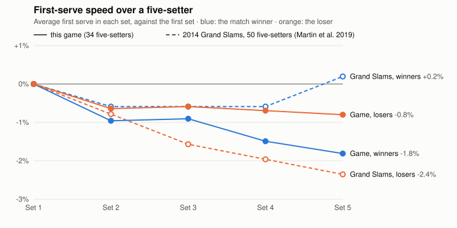
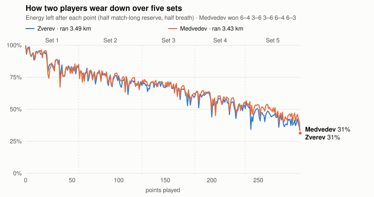

# Stamina

Players tire over a match the way the research says real players do. Their legs slow, their first step loses its
snap, their serve loses a little pace, and a long rally leaves them short of breath, with looser shots, for the
next point or two. This page explains where each number in `src/players/Stamina.js` comes from, how it was turned
into the game's value, and what the game then does compared with real Grand Slam five-setters.

<!-- RESULTS -->
## What it does in the game

Measured by `node tools/stamina.js 90`: 90 best-of-five matches, each player against an identical copy of himself.
Skill is equal, so whatever separates the two late in a match is what the match took out of them. 29 went five
sets. The same matches were then played again with every fatigue effect switched off. The numbers below are as
measured. Nothing was tuned after looking at them.

### Set 1 against set 5, next to real Grand Slam five-setters

|  | Set 1 | Set 5 | Change | Fatigue off | Real five-setters |
| --- | --- | --- | --- | --- | --- |
| First-serve speed, everyone | 184.9 km/h | 182.5 km/h | -1.26% | -0.37% | −1.2% (Martin 2019), −2.4% (Cui 2020), −0.5% (Maquirriain 2016) |
| First-serve speed, match winners | 184.6 km/h | 182.5 km/h | -1.14% | -0.32% | +0.2% (Martin 2019) |
| First-serve speed, match losers | 185.1 km/h | 182.6 km/h | -1.35% | -0.43% | −2.4% (Martin 2019) |
| First serves in | 63.1% | 63.3% | +0.2 pts | -3.7 pts | +1.6, +2, −0.8 pts (Cui 2020; Martin 2019; Maquirriain 2016) |
| Errors per point, everyone | 0.344 | 0.331 | -3.8% | +0.9% | no significant change across sets (Cui 2020) |
| Errors per point, winners / losers | 0.332 / 0.357 | 0.305 / 0.356 | -8.1% / -0.3% | -4.2% / +6.0% | — |
| Distance per point | 11.1 m | 11.4 m | +2.7% | — | 10.3 → 10.6 m (Cui 2020); no difference between sets (Armstrong 2024) |
| Time between shots | 1.316 s | 1.336 s | +1.5% | +0.4% | 1.19 → 1.23 s, +3.4% (Carboch 2018) |

<picture><source media="(prefers-color-scheme: dark)" srcset="serve-dark.svg"></picture>

**What the numbers say:**
- **Serve speed.** The game's first serves change by -1.26% from set 1 to set 5 (95% interval over the 29 five-setters: -1.98% to -0.55%). The real five-setters show −0.5% to −2.4%, −1.43% combined, the figure the game is built on. The game's change is inside their range, and −1.43% is inside the game's interval.
  *Where the change comes from.* Within each type of serve, at the set-1 mix of types, first serves change by -1.53% (-1.94% to -1.11%), and by -0.31% (-0.71% to +0.05%) with fatigue off. The server's arm store averages 0.107 at the first serves of set 1 and 0.891 in set 5, so the model expects -1.40%, inside the within-type interval. The rest of the overall change, +0.27 points, is the change in the mix of serves (share of first serves, set 1 → set 5: Flat 66% → 68%, Kick 4.3% → 4%, Slice 29.7% → 28%). In a controlled check (the same matches with the arm store held at 0 and at 1, all else equal), first serves change by -1.53% at 1 (185.97 → 183.12 km/h).
  Real winners keep their speed and real losers lose it (Martin 2019). In the game the winners change by -1.14% and the losers by -1.35%. The losers' change minus the winners' is -0.19 points (95% interval -1.22% to +0.73 points), so this sample cannot tell whether winners or losers slow more.
- **First serves in** change by +0.2 points (-3.7 points with fatigue off). The real datasets move by −0.8 to +2 points.
- **Errors per point** change by -3.8% overall (+0.9% with fatigue off). Real Grand Slam data show no significant change. The eventual winner's change is -8.1% and the loser's -0.3%; with fatigue off they are -4.2% and +6.0%.
- **Distance per point** changes by +2.7% and **time between shots** by +1.5% (+0.4% with fatigue off). Carboch & Sklenářik measured +3.4% for the time between shots. The game's distance per point, 11.1, 11.5, 11.3, 11.1, 11.4 m in sets 1 to 5, is above the published range (6.46–10.7 m) in every set.
- **Who wins the fifth set.** The player who had run further in sets 1–4 won 58.6% of 29 fifth sets, within chance at this sample size (50% ± 18). With fatigue off: 65.1%.
- **A fitter player.** A copy one standard deviation fitter (Stamina 90) beat his average copy in 55.6% of 45 matches, within chance at this sample size (50% ± 15), and in 43.8% of the 16 that reached a fifth set, within chance at this sample size (50% ± 25). He ended with 3.4 points more energy.

<picture><source media="(prefers-color-scheme: dark)" srcset="energy-dark.svg"></picture>

One five-setter from the run, Medvedev winning 6–4 6–7(4) 7–6(4) 4–6 6–4: Zverev ran 3.21 km, Medvedev ran 3.13 km. Each dip is a long rally. The line comes back between points as the breath does.

Calibration in this run: an average five-setter took 49,645 J/kg of running and 1,022 of stroke cost. The game uses Stamina.LEGS 48,400 and ARM 1,010, set from an earlier run of the same measurement. This run differs from them by +2.6% and +1.2%, against a 95% margin of ±5.8% and ±4.8% on this run's averages: both inside it.
<!-- /RESULTS -->

## How a measurement becomes a game value

Every number follows the same rules:

1. **Only measured effects go in.** Where a decline has been measured in tennis players, the game uses it. Where
   nothing has been measured, the game adds nothing (0) rather than guess.
2. **Match data over lab data.** Real Grand Slam matches come first. Lab protocols are used only where match data do
   not exist, and newer studies are preferred.
3. **Where studies disagree, a stated rule picks the value.** Either they are averaged by sample size, or the
   larger match sample wins. Each row below says which.
4. **One unit for the long-term stores.** The legs and arm stores read **1 at the end of an average five-set
   match**. Real five-setters last 212 ± 27 minutes (50 five-setters at the 2014 Grand Slams, Martin et al. 2019).
   That is the same length as the 3–4 hour matches over which the lab declines were measured (Girard et al. 2006;
   Martin et al. 2016; Gescheit et al. 2015). So a decline measured at the end of a long match is the effect at 1,
   unchanged.
5. **Calibrated against the game, then checked against real matches.** `tools/stamina.js` measures how much
   running and hitting an average five-setter takes in the game, and sets the stores so they read 1 at its end. It
   then compares the game with real five-setters set by set (the results above).

## The model

Three stores, because tennis fatigue works on three time scales:

| Store | Fills with | Empties | Reads 1 at |
|---|---|---|---|
| **Legs** | running in play, priced by metabolic power | never during a match | the end of an average five-setter |
| **Arm** | each stroke, priced by the square of the ball's speed | never during a match | the end of an average five-setter |
| **Breath** | running harder than critical power (CP) | between points and at changeovers, in two phases | exhaustion (W′ spent) |

- **Running cost.** Accelerating at *a* costs what running uphill on a slope of *a*/g does (di Prampero et al.
  2005). Minetti's polynomial gives that cost per metre: 3.6 J/kg on the flat. The game charges every step a player
  takes in play this way (Osgnach et al. 2010 apply the same method to football). Turning sharply is charged as half
  a forward acceleration.
- **Stroke cost.** The racket's kinetic energy grows with the square of its speed, and the ball leaves at a speed in
  proportion to it. So a stroke costs (ball speed / 30 m/s)². A 108 km/h groundstroke costs 1, and a 200 km/h first
  serve 3.4.
- **Breath** is the W′ of the critical power model (Jones & Vanhatalo 2017). Power above CP spends it, and below
  CP it comes back. During a rally it comes back more slowly the closer the effort is to CP (Skiba et al. 2012;
  Chorley et al. 2023).
- **Effects** are in proportion to each store. The legs and arm keep counting up to 1.5, for matches longer than an
  average five-setter.

## Where each number comes from

### Constants of the body

| Game value | What was measured | Source | How it became the game value |
|---|---|---|---|
| CP **17.2 W/kg** | Second ventilatory threshold of 20 competitive players: 49.4 mL/kg/min, 84% of a VO2max of 58.0 ± 4.6 | Baiget et al. 2015 | 49.4 mL × 20.9 J per mL of oxygen ÷ 60 s. CP lies at 70–90% of VO2max (Jones & Vanhatalo 2017), and 84% is inside that range |
| W′ **1181 J/kg** | D′ (the distance a runner can cover above critical speed) of 12 elite runners: 328 ± 104 m | Jones & Vanhatalo 2017, Table 1 | 328 m × 3.6 J/kg per metre on the flat |
| Breath back in two phases: **τ 21.5 s** and **τ 388 s** | After exhaustion, W′ returned 50.7% fast (τ 21.5 s) and 49.3% slow (τ 388 s), in 10 trained cyclists | Chorley et al. 2022 (two phases also in Caen et al. 2021) | Used as measured |
| Slow share **49.3% × how deep the player already is** | After a partial depletion no slow phase appears. Singles tennis keeps blood lactate at 1–2 mmol/L, and players spend 97% of play below VT2 | Lievens et al. 2024; Armstrong et al. 2023; Baiget et al. 2015 | Runs from 0 when fresh (ordinary points come back within the 25 s) to Chorley's 49.3% at exhaustion. With a fixed 49.3%, ordinary play left every player half spent and errors rose to 35.7%, against the tour's ~28% |
| Recovery in play **× (CP − P)/CP** | W′ recovers more slowly the closer recovery power is to CP | Skiba et al. 2012; Chorley et al. 2023 | Recovery rate in proportion to the gap below CP |
| Rest **25 s / 90 s / 120 s** | The rules' time between points, at a changeover, between sets | ITF rules | Only breath recovers in that time. The legs and arm declines were measured over whole matches, changeovers included |
| LEGS **48,400 J/kg**, ARM **1,010** | Running work and stroke cost of an average five-setter in the game, with the fitted players and the corrected movement: 48,361 J/kg (28 five-setters of 90 matches), and 1,013 after the players were fitted again (40 five-setters of 90) | `node tools/stamina.js` | Rounded to three figures, so the stores read 1 when an average five-setter ends. Set again whenever a run falls outside its own 95% margin |

### What each store costs at 1

| Effect | Game value | What was measured | Source | How it became the game value |
|---|---|---|---|---|
| Top speed (legs) | **−3.1%** | Sprint time +3.1% after a match, 12 players | Girard et al. 2014 | Used as measured. Those matches were about 2 h, so the true five-set figure is likely larger; this is the conservative choice |
| First step, braking, cutting (legs) | **−8.0%** | Maximal leg strength −9% and leg stiffness −9% after 3 h; strength −7.7% after a 1.5 h protocol; leg stiffness −6.5% after a match | Girard et al. 2006; Poignard et al. 2023; Girard et al. 2014 | Mean of the four: (9 + 9 + 7.7 + 6.5) / 4 |
| First-serve speed (arm) | **−1.79%** | Set 1 → set 5 of Grand Slam five-setters: −1.2% (100 players), −2.4% (56 fifth sets), −0.5% (30 players) | Martin et al. 2019; Cui et al. 2020; Maquirriain et al. 2016 | Mean weighted by sample size, −1.43%: (100 × 1.17 + 56 × 2.38 + 30 × 0.51) / 186. That compares set averages. The arm store grows steadily, so in an average five-setter its set-1 average is 0.1 and its set-5 average 0.9, 0.8 apart. The effect at 1 is therefore −1.43% ÷ 0.8 |
| Serve accuracy (arm) | **0** | First serves in, set 1 → 5: 59.5 → 61.1%, 62 → 64%, 63.1 → 62.3%. Double faults unchanged | Cui et al. 2020; Martin et al. 2019; Maquirriain et al. 2016 | No change in any of the three |
| Groundstroke speed (arm) | **−1.79%** | Falls over a 2 h 40 min lab protocol; no match figure exists | Hornery et al. 2007 | The serve's share, as the only match measure of the racket arm's output. This is the one value carried over from another stroke |
| Groundstroke errors (legs, arm) | **0** | Across sets of 146 Grand Slam matches, return errors 3.6% → 3.0% and winners per error 1.1 → 1.2, no rise. A smaller study of 8 players found forehand success 75.2% → 65.5% | Cui et al. 2020; Pereira et al. 2016 | The larger match sample wins. Tired legs still cost accuracy indirectly: a slower player reaches the ball later and more stretched, and the game's stretch penalty applies |
| Walking back between points (legs) | **−13.1%** | Time between points 20.91 s in set 1, 23.11 s in set 5, in 5 Australian Open five-setters | Carboch & Sklenářik 2018 | 23.11 / 20.91 − 1 = +10.5%, between set averages, so ÷ 0.8 as for the serve |

### What the breath store costs at 1 (exhaustion)

| Effect | Game value | What was measured | Source | How it became the game value |
|---|---|---|---|---|
| Groundstroke spread | **× 2.0** | Hitting accuracy −69% at volitional exhaustion | Davey et al. 2002 | If a target is hit with probability p, a 69% drop means hitting it with probability 0.31p. For a round target and normal scatter, that takes a spread 1.9–2.1 times wider, for any p from 0.3 to 0.6 (worked in `tests/stamina.test.js`) |
| Serve spread | **× 1.3** | Serve accuracy −30% at exhaustion; serve precision 6.00 → 4.00 (−33%) after a 15 × 20 m shuttle run (perceived effort 9 out of 10) | Davey et al. 2002; Bilić et al. 2023 | The same conversion gives 1.27–1.33 |
| Top speed, first step | **−9.5%** | Change-of-direction test 11.75 → 12.99 s after the same shuttle run, 21 players | Bilić et al. 2023 | 11.75 / 12.99 − 1 |
| Groundstroke speed | **0** | Forehand speed 122.2 → 120.4 km/h after 10 consecutive hard forehands (not significant) | Brito et al. 2022 | No measured change |

### Who is fitter

Aerobic fitness sets how fast W′ comes back (Caen et al. 2021; Lievens et al. 2024). It also sets how hard ordinary
play is for a player: fitter players play at a lower share of their maximum (Baiget et al. 2015). One standard
deviation of tennis players' VO2max is 4.6 of 58.0 mL/kg/min, or **7.9%** (Baiget et al. 2015). A player one SD
fitter therefore fills legs and arm 7.9% more slowly and gets his breath back 7.9% faster. On the player card that is
**Stamina 90** against the field's **75**.

No VO2max has been published for these players. The only stamina-related record that is published is the five-set
record, and ATP published it for three of the thirteen (ATP Tour, January 2025): **Borg 27–6**, the best in the Open
Era; **Djokovic 40–11**, third; and **Alcaraz 12–1**, too few matches to qualify. These three are rated one SD fitter.
Everyone else is the field average, because nothing published says otherwise. A five-set record also reflects skill,
so the step is kept to one SD rather than scaled to the records.

### Corrected

The first version put the set-1-to-set-5 serve decline (−1.43%) in as the effect of a full arm store, so a game
five-setter could only show about 0.7 of it. That was an error in the conversion, not in the data. The effect at 1 is
now the set-to-set change ÷ 0.8, the gap between the set-1 and set-5 averages of a store that grows steadily. The
same correction applies to groundstroke speed and to walking between points. The declines measured from before a
match to after it (sprint, strength) were converted correctly and are unchanged.

After the change to how players move (shorter runs, fewer trips to the net; see docs/players), an average
five-setter took 48,361 J/kg of running and 1,072 of stroke cost instead of 58,800 and 1,120. Legs therefore ended an
average five-setter at about 0.82 instead of 1. LEGS and ARM were set again from that measurement, as the calibration
says. After that, rally directions were counted by the Match Charting Project's own rule and the players fitted again
(see docs/players). The next run measured 1,013 of stroke cost against ARM 1,070, −5.3%, outside that run's ±4.7%
margin, so ARM was set again to 1,010. LEGS was inside its margin (−0.8% against ±6.2%) and stayed. No effect size
changed.

### Removed from the first version, for lack of evidence

- Endurance ratings set by reputation (Nadal 1.18, Sampras 0.86 and so on).
- Fatigue carried into the next round of a tournament. All physical markers are back to baseline within 24 hours
  (Girard et al. 2014; Poignard et al. 2023), and Grand Slam rounds are 48 hours apart.
- Recovery of legs and arm while seated at changeovers, which the measured declines already include.
- Long-term effects on serve accuracy and groundstroke errors, which match data do not show (see above).

## Perfect timing: a game rule

This one is not a measurement. A shot timed **Perfect** is struck clean on the sweet spot, so tiredness does not
show in its accuracy or pace, and the arm feels half of it. A **Good** shot takes half the fatigue penalty. The
reasoning: a clean strike on the sweet spot sends the least shock up the arm, and a well-prepared swing needs no
extra effort to make up for tired legs. It rewards the player for timing well when tired, which is when it matters
most.

## Limits

- **W′ comes from runners.** D′ was measured in marathon runners, not tennis players. Tennis players probably have
  a larger one, which would make breath run out more slowly.
- **Breath recovery comes from cyclists** (Chorley et al. 2022), and the split by depth interpolates between two
  measured end points.
- **Two exhaustion figures are dated.** The groundstroke figure is from 2002 (Davey et al.). The serve figure agrees
  with a 2023 study (Bilić et al.), but no newer study measures groundstroke accuracy at exhaustion.
- **The game's players still run more than real ones.** A man covers 6.46 m a point by Hawk-Eye at the Australian
  Open (Armstrong et al. 2024), 10.3–10.7 m by official match statistics (Cui et al. 2020) and 9.6 m by a
  meta-analysis (Pluim et al. 2023). After the change to how players move, the game's players cover 10.5 m a point
  in one-set matches between different players (docs/players) and 11.1–11.5 m in this run's five-setters between
  identical copies (see the results), down from about 14 m before it. That is level with or above the official
  statistics, and well above the Hawk-Eye figure. Legs and arm are calibrated to the game's own five-setter, so this
  does not inflate the match-long effects. Breath works on real physiology, so any extra running reaches it in full.
- **The serve also slows within a single game.** Serve speed fell 141.7 → 134.9 km/h within a prolonged 12-point
  service game (Brito et al. 2025). How hard that protocol was is not reported in a way that maps onto W′, so it is
  left out.
- **Pacing is not modelled.** Real players pace themselves (Reid & Duffield 2014; Martin et al. 2019), and the
  game's computer players do not.

## References

PubMed was used to check paper details and DOIs where the paper is indexed there.

- Armstrong C, Peeling P, Murphy A, Reid M (2024). Navigating the court: a comparison of distance demands between sexes in Grand Slam tennis. *J Sports Sci Med* 23:1–7. [doi:10.52082/jssm.2024.1](https://doi.org/10.52082/jssm.2024.1)
- Armstrong C, Reid M, Beale C, Girard O (2023). A comparison of match load between padel and singles and doubles tennis. *Int J Sports Physiol Perform* 18:512–522. [doi:10.1123/ijspp.2022-0330](https://doi.org/10.1123/ijspp.2022-0330)
- ATP Tour (12 January 2025). Who has the best five-set record in tennis? [atptour.com](https://www.atptour.com/en/news/australian-open-2025-best-five-set-records)
- Baiget E, Fernández-Fernández J, Iglesias X, Rodríguez FA (2015). Tennis play intensity distribution and relation with aerobic fitness in competitive players. *PLoS One* 10:e0131304. [doi:10.1371/journal.pone.0131304](https://doi.org/10.1371/journal.pone.0131304)
- Bilić Z, Sinković F, Barbaros P, Novak D, Zemkova E (2023). Exercise-induced fatigue impairs change of direction performance and serve precision among young male tennis players. *Sports* 11:111. [doi:10.3390/sports11060111](https://doi.org/10.3390/sports11060111)
- Brito AV, Carvalho DD, Fonseca P, et al. (2022). Shoulder torque production and muscular balance after long and short tennis points. *Int J Environ Res Public Health* 19:15857. [doi:10.3390/ijerph192315857](https://doi.org/10.3390/ijerph192315857)
- Brito AV, Carvalho D, Silva M, et al. (2025). The effect of a prolonged tennis serve game on shoulder function, speed and precision. *Sports Biomech* 24:3655–3674. [doi:10.1080/14763141.2025.2552172](https://doi.org/10.1080/14763141.2025.2552172)
- Caen K, Bourgois G, Dauwe C, et al. (2021). W′ recovery kinetics after exhaustion: a two-phase exponential process influenced by aerobic fitness. *Med Sci Sports Exerc* 53:1911–1921. [doi:10.1249/MSS.0000000000002673](https://doi.org/10.1249/MSS.0000000000002673)
- Carboch J, Sklenářik M (2018). Rally pace development in five-set matches at the Australian Open 2017. *Studia Kinanthropologica* 19(1):7–13. [sk.pf.jcu.cz](https://sk.pf.jcu.cz/artkey/stk-201801-0001_vyvoj-tempa-hry-v-petisetovych-utkanich-na-australian-open-2017.php)
- Chorley A, Bott RP, Marwood S, Lamb KL (2022). Bi-exponential modelling of W′ reconstitution kinetics in trained cyclists. *Eur J Appl Physiol* 122:677–689. [doi:10.1007/s00421-021-04874-3](https://doi.org/10.1007/s00421-021-04874-3)
- Chorley A, Marwood S, Lamb KL (2023). A dynamic model of the bi-exponential reconstitution and expenditure of W′ in trained cyclists. *Eur J Sport Sci* 23:2368–2378. [doi:10.1080/17461391.2023.2238679](https://doi.org/10.1080/17461391.2023.2238679)
- Cui Y, Liu H, Gómez MÁ, Liu H, Gonçalves B (2020). Set-to-set performance variation in tennis Grand Slams: play with consistency and risks. *J Hum Kinet* 73:153–163. [doi:10.2478/hukin-2019-0140](https://doi.org/10.2478/hukin-2019-0140)
- Davey PR, Thorpe RD, Williams C (2002). Fatigue decreases skilled tennis performance. *J Sports Sci* 20:311–318. [doi:10.1080/026404102753576080](https://doi.org/10.1080/026404102753576080)
- di Prampero PE, Fusi S, Sepulcri L, et al. (2005). Sprint running: a new energetic approach. *J Exp Biol* 208:2809–2816. [doi:10.1242/jeb.01700](https://doi.org/10.1242/jeb.01700)
- Gescheit DT, Cormack SJ, Reid M, Duffield R (2015). Consecutive days of prolonged tennis match play: performance, physical, and perceptual responses in trained players. *Int J Sports Physiol Perform* 10:913–920. [doi:10.1123/ijspp.2014-0329](https://doi.org/10.1123/ijspp.2014-0329)
- Girard O, Lattier G, Micallef JP, Millet GP (2006). Changes in exercise characteristics, maximal voluntary contraction, and explosive strength during prolonged tennis playing. *Br J Sports Med* 40:521–526. [doi:10.1136/bjsm.2005.023754](https://doi.org/10.1136/bjsm.2005.023754)
- Girard O, Christian RJ, Racinais S, Périard JD (2014). Heat stress does not exacerbate tennis-induced alterations in physical performance. *Br J Sports Med* 48:i39–i44. [doi:10.1136/bjsports-2013-093165](https://doi.org/10.1136/bjsports-2013-093165)
- Hornery DJ, Farrow D, Mujika I, Young WB (2007). Caffeine, carbohydrate, and cooling use during prolonged simulated tennis. *Int J Sports Physiol Perform* 2:423–438. [doi:10.1123/ijspp.2.4.423](https://doi.org/10.1123/ijspp.2.4.423)
- Jones AM, Vanhatalo A (2017). The 'critical power' concept: applications to sports performance with a focus on intermittent high-intensity exercise. *Sports Med* 47(Suppl 1):65–78. [doi:10.1007/s40279-017-0688-0](https://doi.org/10.1007/s40279-017-0688-0)
- Lievens M, Ghijs M, Bourgois JG, et al. (2024). Characterizing the exponential profile of W′ recovery following partial depletion. *Med Sci Sports Exerc* 56:1770–1781. [doi:10.1249/MSS.0000000000003468](https://doi.org/10.1249/MSS.0000000000003468)
- Maquirriain J, Baglione R, Cardey M (2016). Male professional tennis players maintain constant serve speed and accuracy over long matches on grass courts. *Eur J Sport Sci* 16:845–849. [doi:10.1080/17461391.2016.1156163](https://doi.org/10.1080/17461391.2016.1156163)
- Martin C, Bideau B, Delamarche P, Kulpa R (2016). Influence of a prolonged tennis match play on serve biomechanics. *PLoS One* 11:e0159979. [doi:10.1371/journal.pone.0159979](https://doi.org/10.1371/journal.pone.0159979)
- Martin C, Bideau B, Touzard P, Kulpa R (2019). Identification of serve pacing strategies during five-set tennis matches. *Int J Sports Sci Coach* 14:32–42. [doi:10.1177/1747954118806682](https://doi.org/10.1177/1747954118806682)
- Osgnach C, Poser S, Bernardini R, Rinaldo R, di Prampero PE (2010). Energy cost and metabolic power in elite soccer: a new match analysis approach. *Med Sci Sports Exerc* 42:170–178. [doi:10.1249/MSS.0b013e3181ae5cfd](https://doi.org/10.1249/MSS.0b013e3181ae5cfd)
- Pereira TJC, Nakamura FY, de Jesus MT, et al. (2016). Analysis of the distances covered and technical actions performed by professional tennis players during official matches. *J Sports Sci* 35:361–368. [doi:10.1080/02640414.2016.1165858](https://doi.org/10.1080/02640414.2016.1165858)
- Pluim BM, Jansen MGT, Williamson S, et al. (2023). Physical demands of tennis across the different court surfaces, performance levels and sexes: a systematic review with meta-analysis. *Sports Med* 53:807–836. [doi:10.1007/s40279-022-01807-8](https://doi.org/10.1007/s40279-022-01807-8)
- Poignard M, Guilhem G, Jubeau M, et al. (2023). Cold-water immersion and whole-body cryotherapy attenuate muscle soreness during 3 days of match-like tennis protocol. *Eur J Appl Physiol* 123:1895–1909. [doi:10.1007/s00421-023-05190-8](https://doi.org/10.1007/s00421-023-05190-8)
- Reid M, Duffield R (2014). The development of fatigue during match-play tennis. *Br J Sports Med* 48:i7–i11. [doi:10.1136/bjsports-2013-093196](https://doi.org/10.1136/bjsports-2013-093196)
- Skiba PF, Chidnok W, Vanhatalo A, Jones AM (2012). Modeling the expenditure and reconstitution of work capacity above critical power. *Med Sci Sports Exerc* 44:1526–1532. [doi:10.1249/MSS.0b013e3182517a80](https://doi.org/10.1249/MSS.0b013e3182517a80)
