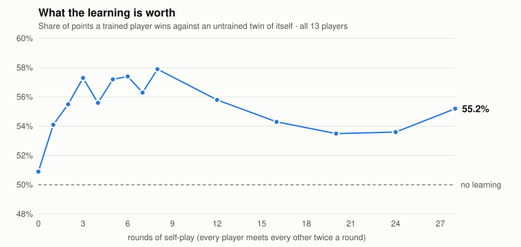

# How the players learn

The computer players are not scripted. Each one keeps a table of **what has worked for it** — which serve to which
corner, cross-court or down the line, when to come in, how to pass a player at the net — and that table is filled in
by playing. This page is the record of that learning. It is rebuilt by `tools/train.js` every time the players train
(a GitHub Action runs it daily), so the numbers below are the current ones.

## The result

<picture><source media="(prefers-color-scheme: dark)" srcset="learning-dark.svg"></picture>

After **36 rounds** of self-play (236,093 points), a trained player wins **54.1% of points** and
**76.9% of sets** against an untrained copy of itself — same serve, same speed, same strokes, only the decisions
differ. Before any training the same measurement gave 50.9% (50% is the expected value; the rest is noise in
a sample of 2,505 points).

<picture><source media="(prefers-color-scheme: dark)" srcset="players-dark.svg"></picture>

| Date | Rounds | Points played in training | Points won vs untrained twin | Sets won | Points in the sample |
|---|---|---|---|---|---|
| 2026-11-15 | 0 | 0 | 50.9% | 59.6% | 2,505 |
| 2026-11-15 | 1 | 6,343 | 54.1% | 76.9% | 2,211 |
| 2026-11-15 | 2 | 12,693 | 55.5% | 84.6% | 2,295 |
| 2026-11-15 | 3 | 19,332 | 57.3% | 82.7% | 2,080 |
| 2026-11-15 | 4 | 25,832 | 55.6% | 80.8% | 2,188 |
| 2026-11-15 | 5 | 32,077 | 57.2% | 84.6% | 1,993 |
| 2026-11-15 | 6 | 38,094 | 57.4% | 84.6% | 2,011 |
| 2026-11-15 | 7 | 44,630 | 56.3% | 80.8% | 2,189 |
| 2026-11-15 | 8 | 50,983 | 57.9% | 86.5% | 2,008 |
| 2026-11-15 | 12 | 75,965 | 55.8% | 75.6% | 3,251 |
| 2026-11-17 | 16 | 103,241 | 54.3% | 75.6% | 3,562 |
| 2026-11-18 | 20 | 129,884 | 53.5% | 71.8% | 3,381 |
| 2026-11-18 | 24 | 156,630 | 53.6% | 71.8% | 3,430 |
| 2026-11-20 | 28 | 182,927 | 55.2% | 82.1% | 3,177 |
| 2026-11-20 | 32 | 209,056 | 53.4% | 73.1% | 3,448 |
| 2026-11-21 | 36 | 236,093 | 54.1% | 76.9% | 3,350 |

Each row is one measurement. A single measurement of all players is good to about ±1 percentage point; one player's
bar in the second chart rests on far fewer points and is good to about ±3.

## The model

- **Situations.** A choice is always made in a situation the player can see: first or second serve and which court;
  returning a first or a second serve, and whether the server is coming in; the first ball after the player's own
  serve; a forehand or backhand rally ball, with the opponent covering the cross-court, in the middle or caught on
  the line side, and with or without time to set up; a short ball; the opponent at the net; at full stretch.
- **Choices.** In each situation there is a short list of tactics (where to serve and with which serve, cross-court,
  down the line, sharp angle, slice, drop shot, lob, into the open court, behind the opponent, heavy and deep, low at
  the feet, approach, the two passing shots), each with a base weight from the player's style.
- **Reward.** When a point ends, every choice the winner made in it is credited (+1) and every choice the loser made
  is blamed (−1), the latest choice in full and each earlier one 0.6 times as much as the one after it.
- **Update.** Each choice keeps a value *q* between −1 and 1, moved a small step toward each new result
  (*q* ← *q* + α·(*r* − *q*), α = 0.03 in training, 0.05 in match play).
- **Policy.** A tactic is chosen with probability proportional to *weight · e^(β·q)* (β = 1.5 in training so the
  players keep trying things, 2.6 in match play so they use what they know). Nothing is ever ruled out.
- **Self-play.** In a round every player plays a short set against every other player, serving first once and second
  once, all learning at the same time — so each one is learning against opponents who are learning too.
- **In the game.** The published game starts from these values. On Rookie the opponent ignores them, on Pro and
  Legend it plays them, and it keeps learning from the person it is playing; that part stays in the browser.

## The playbook

What each player came to prefer and to avoid. The number is how far the tactic's learned value sits above or below
the average of the other choices in the same situation.

<details><summary><b>Djokovic</b> — 53.6% of points against the untrained twin</summary>

| Situation | Prefers | Value |
|---|---|---|
| Forehand rally, opponent caught on the line side, hurried | heavy and deep down the middle | +0.48 |
| Forehand rally, opponent in the middle, hurried | heavy and deep down the middle | +0.46 |
| Short ball, opponent in the middle | sharp angle | +0.43 |
| Opponent at the net, forehand | pass down the line | +0.41 |

| Situation | Avoids | Value |
|---|---|---|
| Opponent at the net, backhand | low at the feet | -0.56 |
| Short ball, opponent in the middle | approach and come in | -0.48 |
| Return of a second serve | cross-court | -0.40 |

</details>

<details><summary><b>Nadal</b> — 59.5% of points against the untrained twin</summary>

| Situation | Prefers | Value |
|---|---|---|
| Opponent at the net, forehand | pass down the line | +0.68 |
| Short ball, opponent in the middle | cross-court | +0.45 |
| Forehand rally, opponent in the middle, hurried | heavy and deep down the middle | +0.44 |
| Backhand rally, opponent caught on the line side, hurried | heavy and deep down the middle | +0.41 |

| Situation | Avoids | Value |
|---|---|---|
| Return of a second serve against a serve-and-volleyer | low at the feet | -0.45 |
| Opponent at the net, forehand | low at the feet | -0.44 |
| First ball after own serve, backhand | drop shot | -0.41 |

</details>

<details><summary><b>Alcaraz</b> — 54.7% of points against the untrained twin</summary>

| Situation | Prefers | Value |
|---|---|---|
| Short ball, opponent covering cross-court | drop shot | +0.70 |
| Forehand rally, opponent in the middle | drop shot | +0.70 |
| Short ball, opponent covering cross-court | sharp angle | +0.66 |
| Short ball, opponent in the middle | drop shot | +0.66 |

| Situation | Avoids | Value |
|---|---|---|
| Short ball, opponent in the middle | approach and come in | -0.52 |
| Short ball, opponent covering cross-court | down the line | -0.51 |
| Forehand rally, opponent in the middle | hard into the open court | -0.47 |

</details>

<details><summary><b>Federer</b> — 52.9% of points against the untrained twin</summary>

| Situation | Prefers | Value |
|---|---|---|
| First ball after own serve, backhand | cross-court | +0.51 |
| Short ball, opponent in the middle | sharp angle | +0.46 |
| Short ball, opponent covering cross-court | sharp angle | +0.46 |
| Short ball, opponent caught on the line side | cross-court | +0.42 |

| Situation | Avoids | Value |
|---|---|---|
| Short ball, opponent caught on the line side | approach and come in | -0.55 |
| Short ball, opponent in the middle | approach and come in | -0.48 |
| Second serve placement, left court | down the T | -0.37 |

</details>

<details><summary><b>Sinner</b> — 56.7% of points against the untrained twin</summary>

| Situation | Prefers | Value |
|---|---|---|
| Opponent at the net, forehand | pass down the line | +0.53 |
| Short ball, opponent covering cross-court | cross-court | +0.52 |
| Forehand rally, opponent covering cross-court, hurried | heavy and deep down the middle | +0.36 |
| Short ball, opponent caught on the line side | sharp angle | +0.33 |

| Situation | Avoids | Value |
|---|---|---|
| Short ball, opponent caught on the line side | approach and come in | -0.46 |
| Opponent at the net, forehand | low at the feet | -0.43 |
| Return of a second serve against a serve-and-volleyer | low at the feet | -0.41 |

</details>

<details><summary><b>Medvedev</b> — 54.8% of points against the untrained twin</summary>

| Situation | Prefers | Value |
|---|---|---|
| Opponent at the net, forehand | pass down the line | +0.55 |
| Opponent at the net, backhand | pass down the line | +0.48 |
| Forehand rally, opponent caught on the line side, hurried | heavy and deep down the middle | +0.44 |
| Short ball, opponent covering cross-court | cross-court | +0.44 |

| Situation | Avoids | Value |
|---|---|---|
| Opponent at the net, backhand | low at the feet | -0.58 |
| Return of a second serve | down the line | -0.46 |
| Short ball, opponent caught on the line side | down the line | -0.45 |

</details>

<details><summary><b>Zverev</b> — 52.3% of points against the untrained twin</summary>

| Situation | Prefers | Value |
|---|---|---|
| Opponent at the net, backhand | pass down the line | +0.49 |
| Short ball, opponent caught on the line side | cross-court | +0.45 |
| Opponent at the net, forehand | pass down the line | +0.44 |
| Short ball, opponent covering cross-court | cross-court | +0.41 |

| Situation | Avoids | Value |
|---|---|---|
| Opponent at the net, forehand | low at the feet | -0.49 |
| Short ball, opponent caught on the line side | approach and come in | -0.46 |
| Opponent at the net, backhand | low at the feet | -0.44 |

</details>

<details><summary><b>de Minaur</b> — 52.3% of points against the untrained twin</summary>

| Situation | Prefers | Value |
|---|---|---|
| Forehand rally, opponent caught on the line side, hurried | heavy and deep down the middle | +0.49 |
| Return of a second serve | heavy and deep down the middle | +0.49 |
| Backhand rally, opponent caught on the line side, hurried | heavy and deep down the middle | +0.44 |
| Opponent at the net, backhand | pass down the line | +0.43 |

| Situation | Avoids | Value |
|---|---|---|
| First ball after own serve, backhand | down the line | -0.47 |
| Forehand rally, opponent covering cross-court | down the line | -0.45 |
| Opponent at the net, forehand | low at the feet | -0.41 |

</details>

<details><summary><b>Sampras</b> — 52.3% of points against the untrained twin</summary>

| Situation | Prefers | Value |
|---|---|---|
| Forehand rally, opponent in the middle | drop shot | +0.33 |
| Short ball, opponent covering cross-court | cross-court | +0.32 |
| Forehand rally, opponent caught on the line side | drop shot | +0.30 |
| Return of a first serve against a serve-and-volleyer | lob | +0.29 |

| Situation | Avoids | Value |
|---|---|---|
| Opponent at the net, forehand | low at the feet | -0.39 |
| Second serve placement, left court | down the T | -0.38 |
| Forehand rally, opponent covering cross-court | hard into the open court | -0.35 |

</details>

<details><summary><b>Borg</b> — 56.4% of points against the untrained twin</summary>

| Situation | Prefers | Value |
|---|---|---|
| Forehand rally, opponent caught on the line side, hurried | heavy and deep down the middle | +0.55 |
| Opponent at the net, forehand | pass down the line | +0.49 |
| Return of a second serve | safe and deep | +0.43 |
| Forehand rally, opponent covering cross-court, hurried | behind the opponent | +0.43 |

| Situation | Avoids | Value |
|---|---|---|
| Opponent at the net, forehand | low at the feet | -0.49 |
| Second serve placement, right court | down the T | -0.36 |
| Opponent at the net, backhand | low at the feet | -0.35 |

</details>

<details><summary><b>Agassi</b> — 54.2% of points against the untrained twin</summary>

| Situation | Prefers | Value |
|---|---|---|
| Forehand rally, opponent covering cross-court, hurried | heavy and deep down the middle | +0.52 |
| Forehand rally, opponent in the middle, hurried | heavy and deep down the middle | +0.47 |
| Opponent at the net, backhand | pass down the line | +0.39 |
| Opponent at the net, forehand | pass down the line | +0.39 |

| Situation | Avoids | Value |
|---|---|---|
| Opponent at the net, backhand | low at the feet | -0.53 |
| Second serve placement, right court | down the T | -0.42 |
| Return of a second serve against a serve-and-volleyer | low at the feet | -0.41 |

</details>

<details><summary><b>Murray</b> — 52.8% of points against the untrained twin</summary>

| Situation | Prefers | Value |
|---|---|---|
| Opponent at the net, forehand | pass down the line | +0.60 |
| Opponent at the net, backhand | pass down the line | +0.58 |
| First ball after own serve, forehand | heavy and deep down the middle | +0.49 |
| Forehand rally, opponent caught on the line side | heavy and deep down the middle | +0.46 |

| Situation | Avoids | Value |
|---|---|---|
| Opponent at the net, forehand | low at the feet | -0.52 |
| Return of a second serve against a serve-and-volleyer | low at the feet | -0.46 |
| Return of a second serve | cross-court | -0.40 |

</details>

<details><summary><b>McEnroe</b> — 52.2% of points against the untrained twin</summary>

| Situation | Prefers | Value |
|---|---|---|
| Short ball, opponent covering cross-court | drop shot | +0.78 |
| Forehand rally, opponent in the middle | drop shot | +0.46 |
| Backhand rally, opponent covering cross-court | drop shot | +0.44 |
| Forehand rally, opponent in the middle | slice | +0.42 |

| Situation | Avoids | Value |
|---|---|---|
| Short ball, opponent covering cross-court | hard into the open court | -0.43 |
| Short ball, opponent covering cross-court | down the line | -0.38 |
| Backhand rally, opponent covering cross-court | cross-court | -0.35 |

</details>

## What the data says

The shots the players play while training are analysed in **[analysis/](analysis/README.md)**: correlation, entropy and
mutual information, PCA and K-means of the playing styles, decision trees and KNN, and cross-validation — including
of the learning itself.

## Reproduce it

```
node tools/train.js 4          # four more rounds, then one measurement appended to history.json
node tools/train.js 8 4 curve  # eight rounds, measuring after every round (four sets per player)
node tools/train.js eval 40    # measure only, player by player
node tools/report.js           # redraw this page from history.json and learned.js
```
