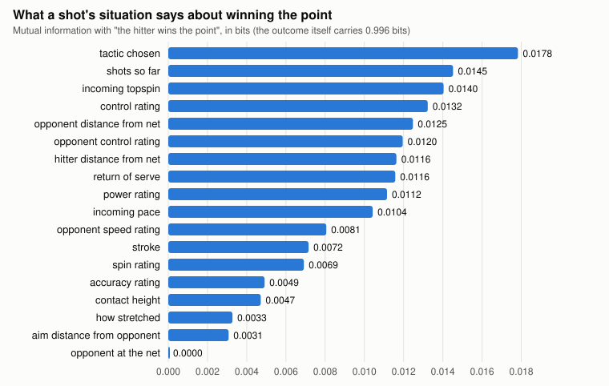
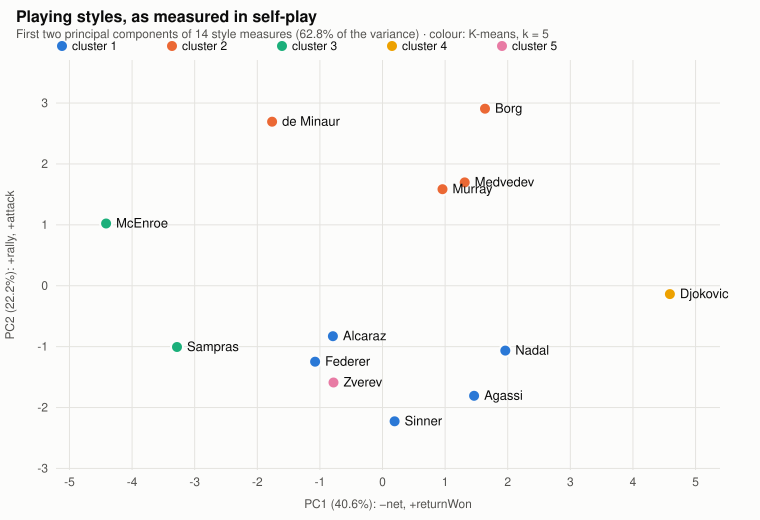

# What the self-play data says

The players' learning (see [the training page](../README.md)) leaves behind a lot of tennis: every shot, the
situation it was played in, the choice made and whether it won the point. This page analyses that data in four
steps — look at it, find its structure, model it, then test the models honestly on data they have not seen. It is
rebuilt by `tools/analysis/collect.js` and `tools/analysis/analyze.js`.

**The data:** 59,660 shots from 312 short sets of self-play (every
player against every other, twice). Each row: 16 numbers describing the situation (how stretched the
hitter is, contact height, incoming pace and spin, both players' positions, where the shot is aimed relative to the
opponent, the rally length, the ratings involved), the stroke, the tactic chosen, and the label — whether the hitter
went on to win the point (46.4% of rows).

## What it found

- **The learning generalises.** Tactics learned from scratch win +4.3 points more than untrained play against opponents met in training, and +5.8 against opponents never met (4-fold cross-validation over players).
- **Situation predicts the point better than chance, not by much.** On unseen matches a decision tree is right 62.2% of the time (macro-F1 0.612) against 53.8% for always guessing the hitter wins; the most informative single facts are tactic chosen, shots so far, opponent distance from net.
- **Measured play recovers the real styles.** K-means on 14 style measures puts the counterpunchers together and the offensive baseliners together (adjusted Rand 0.211 against the known labels); KNN guesses 5 of 13 players' styles from their play alone.
- **Net play is out of balance.** A pass down the line wins 56.2% of its points, a plain volley only 55.1% and a smash 79.3%; on tour the player at the net wins most of those points and a smash nearly always does. This is why serve-and-volley players struggle in the game, and it is the next thing to fix.

## 1. Looking at the data

**Entropy.** The label carries H = 0.996 bits — almost a coin flip. Most of a point is decided by what happens
*after* any single shot, so no feature of one shot can say much; the question is which say anything at all.

**Mutual information** measures, in bits, how much knowing a feature reduces that uncertainty (continuous features
cut into eight equal-count bins first):

<picture><source media="(prefers-color-scheme: dark)" srcset="mi-dark.svg"></picture>

**Pearson correlation** with the label (linear only; mutual information also catches non-linear links):

| Feature | r |
|---|---|
| hitter distance from net | -0.123 |
| control rating | +0.120 |
| return of serve | -0.116 |
| opponent control rating | -0.114 |
| incoming topspin | -0.110 |
| incoming pace | -0.104 |
| power rating | -0.081 |
| opponent speed rating | -0.074 |
| how stretched | -0.063 |
| spin rating | +0.053 |
| shots so far | +0.029 |
| contact height | +0.017 |
| accuracy rating | -0.016 |
| opponent distance from net | +0.013 |
| aim distance from opponent | +0.012 |
| opponent at the net | +0.004 |

**Features that move together** (|r| ≥ 0.4), so a model gains little from having both:

- opponent distance from net ↔ opponent at the net: r = -0.92
- incoming pace ↔ incoming topspin: r = 0.84
- power rating ↔ control rating: r = -0.74
- incoming pace ↔ return of serve: r = 0.74
- incoming topspin ↔ return of serve: r = 0.67
- how stretched ↔ incoming pace: r = 0.58
- incoming topspin ↔ hitter distance from net: r = 0.49
- how stretched ↔ return of serve: r = 0.44
- opponent speed rating ↔ opponent control rating: r = 0.43
- contact height ↔ return of serve: r = 0.43
- return of serve ↔ shots so far: r = -0.40

**Win rate by tactic** (training rows):

| Tactic | Shots | Hitter wins the point |
|---|---|---|
| smash | 323 | 79.3% |
| putaway | 1,210 | 75.0% |
| dropvolley | 373 | 64.6% |
| passline | 1,700 | 56.2% |
| volley | 885 | 55.1% |
| angle | 3,402 | 52.0% |
| deep | 18,881 | 49.2% |
| drop | 523 | 47.0% |
| behind | 2,943 | 46.8% |
| open | 3,060 | 45.3% |
| cross | 11,675 | 44.8% |
| safe | 5,374 | 40.0% |
| approach | 1,604 | 39.2% |
| passcross | 890 | 39.2% |
| slice | 4,760 | 37.6% |
| line | 1,177 | 33.3% |
| lob | 563 | 24.9% |
| dip | 317 | 19.6% |

**Feature selection.** Keeping only the *m* features with the most mutual information, a depth-5 tree scores
(5-fold cross-validation on the training set, macro-F1):

| Features kept | Macro-F1 | Accuracy |
|---|---|---|
| 3 | 0.512 ± 0.028 | 57.5% |
| 6 | 0.574 ± 0.021 | 58.1% |
| 9 | 0.570 ± 0.015 | 59.2% |
| 12 ← used | 0.585 ± 0.019 | 59.8% |
| 18 | 0.584 ± 0.020 | 59.8% |

Kept: tactic chosen, shots so far, opponent distance from net, power rating, control rating, incoming topspin, opponent control rating, return of serve, hitter distance from net, incoming pace, opponent speed rating, stroke.

## 2. Structure: the players' styles

Each player's play is summed up in 14 measures taken from the matches, not from the ratings: attack, steady, defend, net, touch, pass, depth, rally, aces, df, serveWon, returnWon, winners, errors
(shares of shots by kind, average distance from the net, rally length, serve and return points won, winners and
errors per point). Standardised, then **PCA**: the first two components hold 53.8% and
12.6% of the variance.

- PC1: steady +0.35, rally +0.34, depth +0.33, returnWon +0.33
- PC2: errors +0.54, aces +0.43, attack +0.35, winners +0.35

<picture><source media="(prefers-color-scheme: dark)" srcset="styles-dark.svg"></picture>

**K-means** on the standardised measures, k chosen by silhouette:

| k | Silhouette | Agreement with the known styles (adjusted Rand) |
|---|---|---|
| 2 ← chosen | 0.428 | 0.211 |
| 3 | 0.260 | 0.410 |
| 4 | 0.169 | 0.283 |
| 5 | 0.184 | 0.256 |

- **Cluster 1:** Sampras (serve and volley), McEnroe (serve and volley)
- **Cluster 2:** Djokovic (offensive baseliner), Nadal (offensive baseliner), Alcaraz (all-court), Federer (all-court), Sinner (offensive baseliner), Medvedev (counterpuncher), Zverev (offensive baseliner), de Minaur (counterpuncher), Borg (counterpuncher), Agassi (offensive baseliner), Murray (counterpuncher)

The known styles are the tennis world's labels: serve and volley (Sampras, McEnroe), all-court (Federer, Alcaraz),
offensive baseliner (Djokovic, Nadal, Sinner, Agassi, Zverev) and counterpuncher (Murray, Medvedev, de Minaur, Borg).

**KNN, leave-one-out:** each player's style predicted from the three most similar other players (distance-weighted
vote, measures standardised): **5 of 13** right (38.5%).

| Player | Known style | Predicted from play | Most similar player |
|---|---|---|---|
| Djokovic | offensive baseliner | offensive baseliner | de Minaur |
| Nadal | offensive baseliner | offensive baseliner | Agassi |
| Alcaraz | all-court | all-court | Federer |
| Federer | all-court | offensive baseliner ✗ | Zverev |
| Sinner | offensive baseliner | offensive baseliner | Agassi |
| Medvedev | counterpuncher | offensive baseliner ✗ | Zverev |
| Zverev | offensive baseliner | all-court ✗ | Federer |
| de Minaur | counterpuncher | offensive baseliner ✗ | Djokovic |
| Sampras | serve and volley | all-court ✗ | Federer |
| Borg | counterpuncher | offensive baseliner ✗ | Nadal |
| Agassi | offensive baseliner | offensive baseliner | Sinner |
| Murray | counterpuncher | offensive baseliner ✗ | de Minaur |
| McEnroe | serve and volley | all-court ✗ | Sampras |

## 3. Models: can a shot's situation predict the point?

Task: from one shot's situation and choice, predict whether its hitter wins the point. Two classifiers, on the
features kept above:

- **Decision tree** (CART, Gini impurity, leaves of at least 60 shots). Depth by cross-validation:
depth 2: 0.514 · depth 3: 0.558 · depth 4: 0.557 · depth 6: 0.589 · depth 8: 0.596 · depth 10: 0.592 · depth 12: 0.593 · depth 14: 0.591 → **depth 8**.
- **KNN** (z-scored features, scaling fitted on each training fold only, distance-weighted vote; up to 5,000
training rows per fold to keep the Θ(n²) cost reasonable). k by cross-validation: k=5: 0.553 · k=15: 0.573 · k=45: 0.581 · k=95: 0.582
→ **k = 45**.

What a depth-3 tree on every feature learns (training set):

```
47391 shots, 46%
  if isReturn ≤ 0.50: 38028 shots, 49%
    if oppControl ≤ 76.00: 7936 shots, 61%
      if oppDepth ≤ 3.84: → hitter wins 45% (864 shots)
      else: → hitter wins 63% (7072 shots)
    else: 30092 shots, 46%
      if depth ≤ 7.39: → hitter wins 71% (1514 shots)
      else: → hitter wins 45% (28578 shots)
  else: 9363 shots, 35%
    if gap ≤ 2.13: 6153 shots, 40%
      if inPace ≤ 16.73: → hitter wins 45% (2668 shots)
      else: → hitter wins 36% (3485 shots)
    else: 3210 shots, 27%
      if oppControl ≤ 68.50: → hitter wins 38% (456 shots)
      else: → hitter wins 25% (2754 shots)
```

Most important features of the chosen tree (share of the impurity it removes): power 16.3%, depth 15.3%, oppControl 13.6%, isReturn 13.3%, oppDepth 7.1%, oppSpeed 6.9%, gap 6.3%, control 3.9%.

## 4. Evaluation on unseen matches

**Split.** Shots of one match share players and conditions, so the split is by match: 20.6% of
rows (62 whole matches) are held out as the **test set** and used once, at the end.
Everything above — feature selection, depth, k — was chosen by **5-fold cross-validation inside the training set**,
also grouped by match.

| Model (test set) | Accuracy | Precision | Recall | F1 | Macro-F1 |
|---|---|---|---|---|---|
| Always "the hitter wins" (baseline) | 53.8% | 0.0% | 0.0% | 0.000 | 0.350 |
| Tactic only (its training win rate) | 56.9% | 61.1% | 18.4% | 0.283 | 0.488 |
| Decision tree, depth 8 | 62.2% | 61.1% | 50.0% | 0.550 | 0.612 |
| KNN, k = 45 | 61.9% | 60.7% | 49.3% | 0.544 | 0.608 |

Positive class: the hitter wins the point.

**Confusion matrices** (test set):

| Model | True positive | False negative | False positive | True negative |
|---|---|---|---|---|
| Tactic only | 1045 | 4619 | 664 | 5941 |
| Decision tree | 2833 | 2831 | 1804 | 4801 |
| KNN | 2790 | 2874 | 1803 | 4802 |

**Reading it.** The models beat the baseline by 8.4 points of accuracy:
a single shot's situation does carry information about the point — chiefly tactic chosen, shots so far, opponent distance from net — but
tennis points are long chains of shots, and most of the outcome is decided later. That is the honest ceiling for
this task, and it is why the players learn from whole points rather than from single shots.

### Cross-validating the tactics learning itself

The question that matters for the players: is what they learn real, or just fitted to the opponents they trained
against? The thirteen players are dealt into folds; in each, the players outside the fold learn from scratch against
each other only, then play opponents they trained against (in-sample) and the fold's players, whom they never met
(held out).

| Fold | Test players (never met in training) | In-sample advantage | Held-out advantage |
|---|---|---|---|
| 1 | Sinner, McEnroe, Alcaraz, Federer | +5.3 pts | +6.3 pts |
| 2 | de Minaur, Medvedev, Nadal | +3.3 pts | +6.3 pts |
| 3 | Sampras, Zverev, Djokovic | +3.0 pts | +7.3 pts |
| 4 | Agassi, Murray, Borg | +5.8 pts | +3.4 pts |
| **All folds** | | **+4.3 pts** | **+5.8 pts** |

With 2,458 points per version per fold, one fold's figure is good to about ±2.6 points and the pooled one to about ±1.4 (two standard errors). **What is learned carries over to opponents never met: the held-out advantage is as large as the in-sample one, so the players are learning tennis, not the habits of particular opponents.** Advantage = share of points the trained player wins minus the share its untrained twin wins against the same opponent, in percentage points. Each fold trains 3 rounds from scratch; each comparison is 2 short sets with each version.

## Complexity of what runs here

| Step | Time | Space | Notes |
|---|---|---|---|
| Pearson, entropy, mutual information | Θ(n) per feature | O(distinct values) | counting in a hash map |
| Binning for mutual information | Θ(n log n) | Θ(n) | one sort for the cut points, then binary search per value |
| Grouped split / k-fold | Θ(n) | Θ(n) | Fisher–Yates shuffle of the match ids |
| Decision tree, fit | Θ(depth · d · n log n) | Θ(n) | each node sorts its rows per feature and sweeps the thresholds once |
| Decision tree, predict | Θ(depth) per row | — | |
| KNN, predict | Θ(n·d + n log k) per row | Θ(k) heap | a bounded max-heap keeps the k nearest; sorting all n would be Θ(n log n) |
| PCA | Θ(n·d²) + O(d³) per Jacobi sweep | Θ(d²) | d = 14 |
| K-means | Θ(n·k·d) per iteration | Θ(k·d) | k-means++ starts, best of 50 restarts |
| Silhouette | Θ(n²·d) | Θ(k) | n = 13 players |

## Algorithms and data structures in the code, and where they are not used

Used where the problem calls for them:

| Where | Problem | What is used | Cost |
|---|---|---|---|
| `tools/loadorder.py` (every build) | 79 source files must load after whatever they use while loading | a graph of load-time dependencies; **topological sort** (Kahn's algorithm) with a **min-heap** so ties keep the manifest's order; **BFS** for how far a load-time call can reach; **DFS** with white/grey/black colours to name a cycle | O((V + E) log V) for the sort, O(V·(V + E)) for the reach; V = 79 files |
| `KNN` | the k nearest of n rows | a bounded **max-heap** (priority queue) | Θ(n log k) instead of Θ(n log n) |
| `DecisionTree` | the best threshold for a feature | **sorting** the node's rows once, then one sweep | Θ(n log n) instead of Θ(n²) |
| `Stats.bin` | which bin each value falls in | **binary search** over the sorted cut points | O(log q) per value |
| `Stats.entropy`, mutual information | counting outcomes per value | **hash map** | Θ(n) |
| `Validation` | random splits and folds | **Fisher–Yates** shuffle | Θ(n) |
| the game's `Tactics` | the learned value of a tactic in a situation, looked up at every choice | nested **hash maps** (player → situation → tactic) | O(1) per lookup |
| the game's `Tournament` | the draw | a complete **binary tree** stored level by level (quarter-finals → final); a winner moves to slot ⌊i/2⌋ of the next round | O(1) per result |

Not used, on purpose:

- **Dijkstra, Floyd–Warshall, Prim.** Players run straight lines across an open court; the only obstacle is the net,
  and the one walking route that has to avoid it (to and from the tunnel) is three fixed waypoints. A shortest-path
  search would recompute what is already known. Nothing needs a spanning tree.
- **Warshall's transitive closure** would also give the load-time reach above; with 79 files either is instant, and
  a BFS from the few files that are actually called while loading does less work than closing the whole graph (Θ(V³)).
- **BST / AVL tree.** Nothing ordered changes while it is being searched: rankings and seedings of thirteen players
  are sorted once.
- **Linked lists, stacks, queues for the match itself.** A match is a handful of coroutines (the point, the ball
  kids, the walk-on) stepped every tick; with at most a dozen of them, a list scanned once per tick is the simplest
  thing that works. A priority queue of timed events would only pay off with thousands.

## Reproduce

```
node tools/analysis/collect.js 2        # play every pairing twice and record every shot (a few minutes)
node tools/analysis/learning-cv.js 4 3  # 4-fold cross-validation of the tactics learning (about half an hour)
node tools/analysis/analyze.js          # this page and its charts
```
